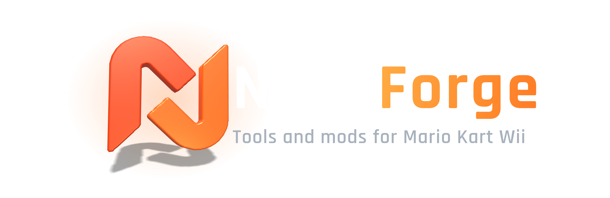
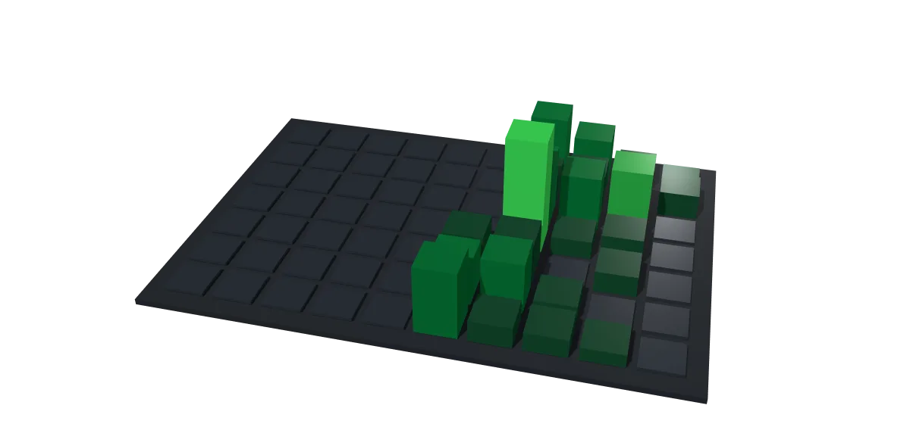

<picture>
<source media="(prefers-color-scheme: light)" srcset="assets/hero-light.webp">

</picture>

## About

We make **Mario Kart Nitro**, a Mario Kart Wii mod for Dolphin, and the tools around it. Everything here is open source and built for the community.

## Projects

### &nbsp;&nbsp;[NitroLauncher](https://github.com/nitroforge/NitroLauncher)

The one-click launcher. It installs the mod, keeps it current and starts Dolphin. Includes a Mii editor and a performance mode.

### &nbsp;&nbsp;[Nitropack](https://github.com/nitroforge/Nitropack)

The content pack: tracks, characters, music and more. The launcher syncs it for you, so nobody copies files by hand.

## Activity

<picture>
<source media="(prefers-color-scheme: light)" srcset="assets/pushes-light.webp">

</picture>

## Build with

## Links

- **Discord:** [Join the community](https://discord.gg/AhkHNPG65G)
- **Launcher:** [NitroLauncher](https://github.com/nitroforge/NitroLauncher)
- **Content pack:** [Nitropack](https://github.com/nitroforge/Nitropack)
- **Found a bug?** [Open an issue](https://github.com/nitroforge/NitroLauncher/issues) or tell us on Discord

 

